# 题了个题 · 桌面版

把开源项目 **StudyOnTV（题了个题）** 的电视端「答题解锁时长」玩法搬到 Windows 电脑上的桌面程序。
纯 Python + tkinter 实现，**不联网、不写注册表、零第三方依赖**，整个文件夹拷走即可使用。

- 上游项目：<https://github.com/chadyi/StudyOnTV>（作者 chadyi，Kotlin / Android TV）
- 本程序定位：以上游的规则引擎与题库格式为准的桌面复刻；遥控器交互改为键鼠交互
- 开发过程与取舍记录：[docs/开发过程.md](docs/开发过程.md)

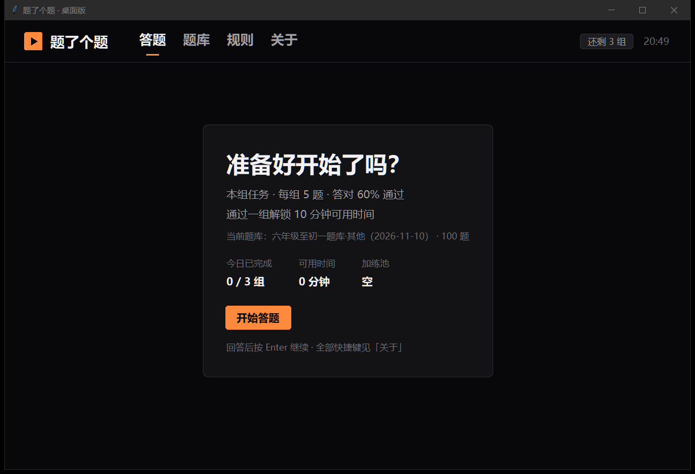

---

## 一、安装（推荐给普通用户）

双击 **`dist\题了个题-0.3.6-安装版.exe`**（8.4 MB），按向导走完即可。

| 项目 | 说明 |
| --- | --- |
| 安装位置 | `%LOCALAPPDATA%\Programs\题了个题`，**不需要管理员权限**，不会弹 UAC |
| 安装体积 | 26 MB（解压后），含 Python 运行时，目标机器**不用装 Python** |
| 数据位置 | `%LOCALAPPDATA%\题了个题\data`（题库、进度、家长密码） |
| 卸载 | 「设置 → 应用 → 已安装的应用」里找「题了个题」，或开始菜单里的「卸载 题了个题」 |
| 卸载时的数据 | 会单独问一次，默认**保留**；选「否」以后重装还能接着用 |

向导里两个可选勾选：

- **创建桌面快捷方式**
- **开机自动启动（建议）**——家长控制要靠它才管得住：孩子开机第一眼看到的是答题锁屏，而不是先点图标。

装完第一次运行会**全屏要求设置家长密码**，设好立刻进入答题锁屏；不设就退出程序。
看到底是什么样，详见第五节。

---

## 二、从源码运行（给改代码的人）

1. 需要 **Windows 10 / 11** 与 **Python 3.9 及以上**（实测 3.13.2，安装时务必包含 tkinter，官方安装包默认包含）。
2. 双击 **`启动.bat`**。
   脚本会自己找一个带 tkinter 的 Python（PATH 里的 `python`、`py -3` 启动器、常见的安装目录都会试），找到后用 `pythonw` 启动，不留黑色命令行窗口。
3. 找不到解释器时会弹中文提示，按提示去 python.org 装一个即可。
4. 想看启动错误、或者要重启程序时，用 **`调试启动.bat`**（带控制台，退出时停住显示退出码）。

命令行方式：

```bat
python run.py
```

手上没有这份源码的话，两条路：不想装 Python 就用 `dist\题了个题-x.y.z-安装版.exe`；想改代码就下 `dist\题了个题-x.y.z-源码版.zip`（解压即是一棵能跑的源码树，或直接 `git clone`）。

程序启动后落在「答题」封面页，点「开始答题」进入一组题；答完一组结算解锁时长，点「开始使用」进入倒计时。

如果已经设过家长密码，启动时会直接进入**全屏锁屏**（不是上面这个窗口），详见第五节。

---

## 三、界面速览

| 页面 | 内容 |
| --- | --- |
| 答题（封面 / 题目 / 自评 / 结算 / 计时 / 拦截） | 一组题的全部状态流转 |
| 题库 | 左栏题库列表（新建 / 导入 / 导出 / 切换 / 重命名），右栏题目表格与搜索 |
| 规则 | 玩法、题量与通过率、解锁时长、每日额度、星级奖励、加练、出题范围、间隔重复、可用时段、主题 |
| 关于 | 玩法说明、与电视端差异、快捷键、最近 7 天记录、数据位置 |

| 题目页 | 作答反馈 |
| --- | --- |
| 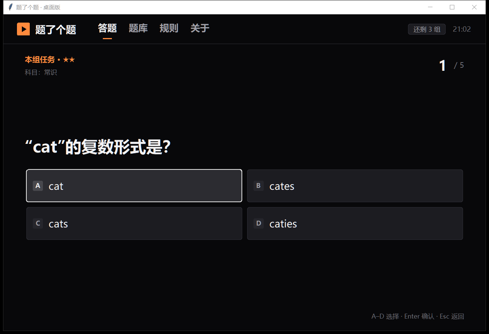 | 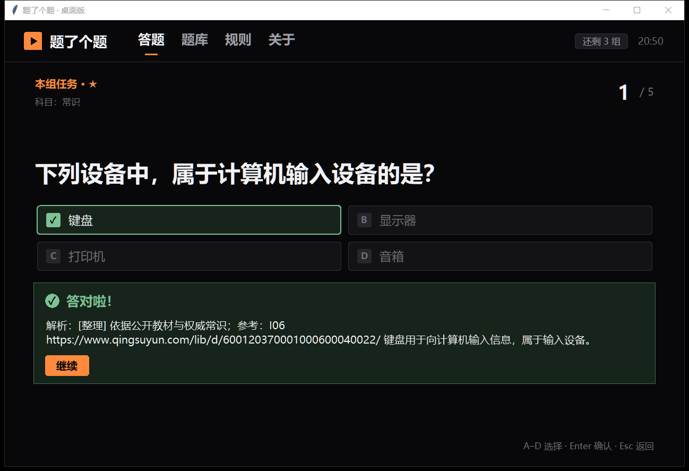 |

| 结算页 | 使用计时 |
| --- | --- |
| 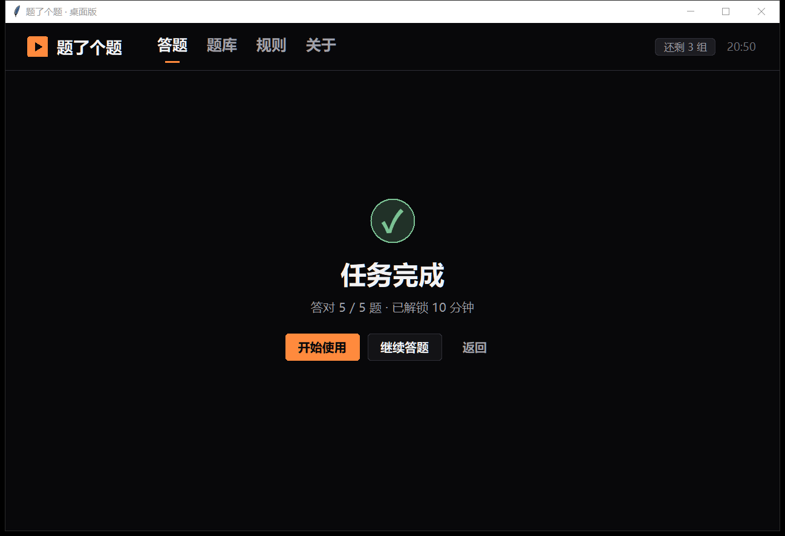 | 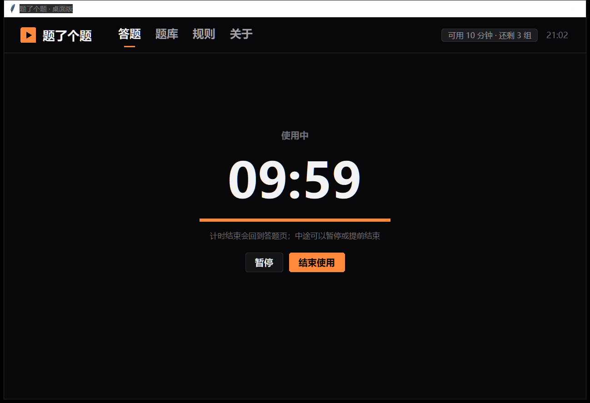 |

主观题没有 AI 批改通道，提交后进入**自评页**：并排显示「你的答案 / 参考答案 / 评分标准」，由作答者自己判定对错（对应上游的 `verdict` 参数）。

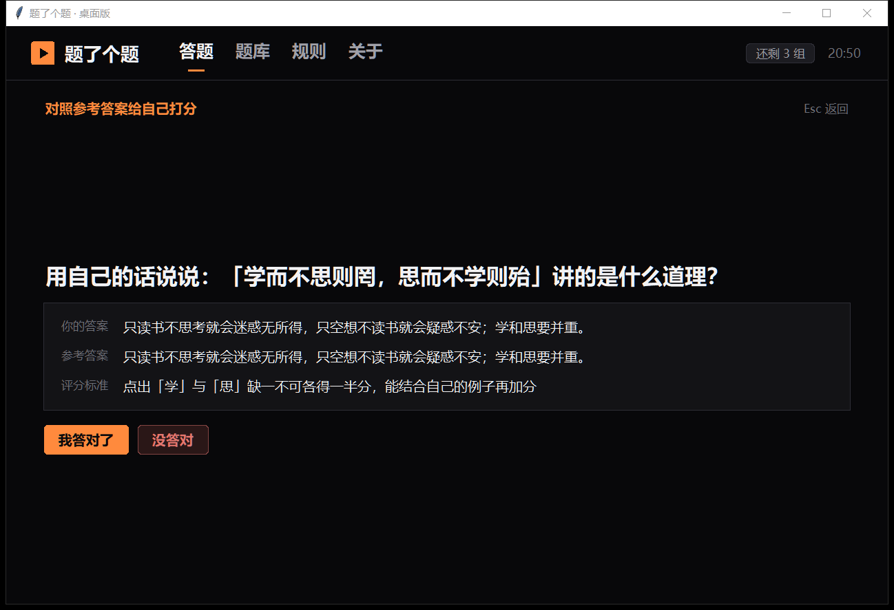

题库、规则、关于三页：

| 题库管理（开关 = 参与出题） | 题目编辑 |
| --- | --- |
| 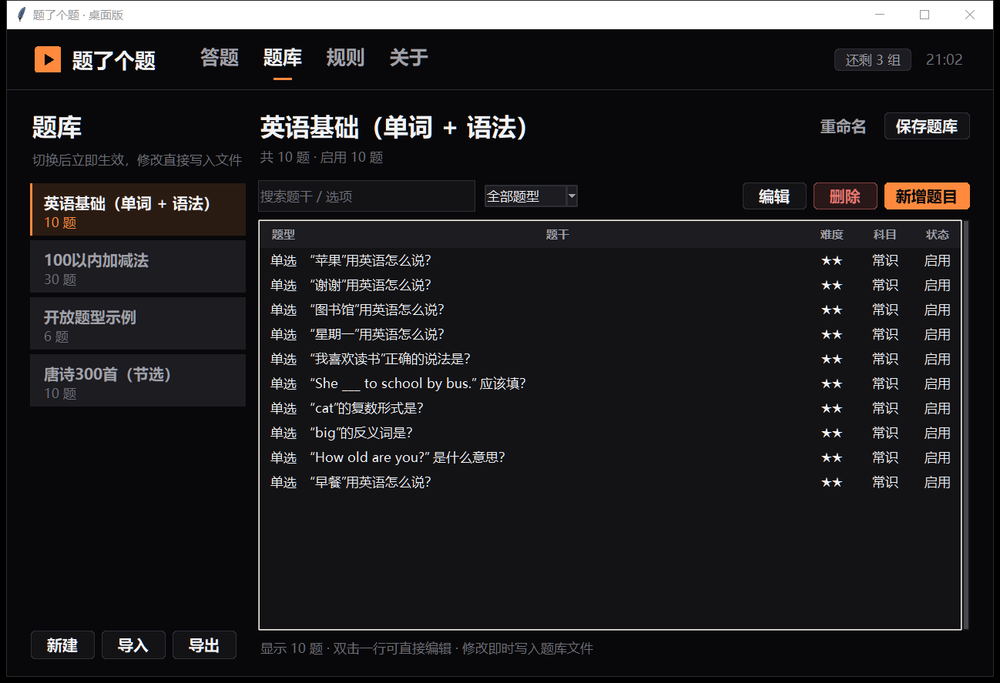 | 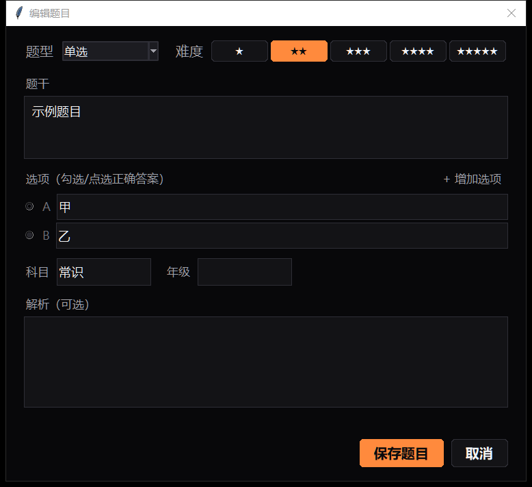 |

答错的题会自动攒成一份「错题库」，跟着一起参与出题：

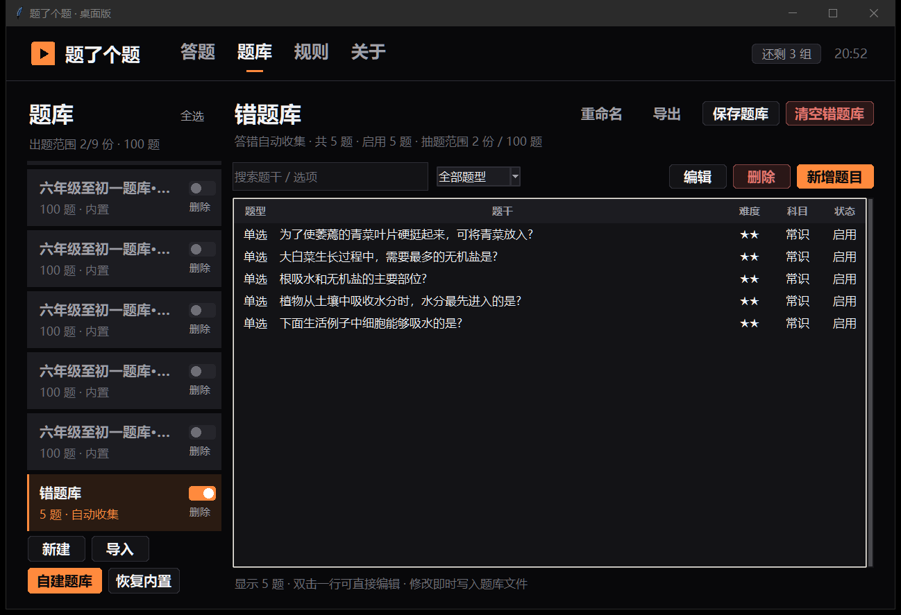

「自建题库」给的提示词，复制给任意大模型就能按本程序格式产题：

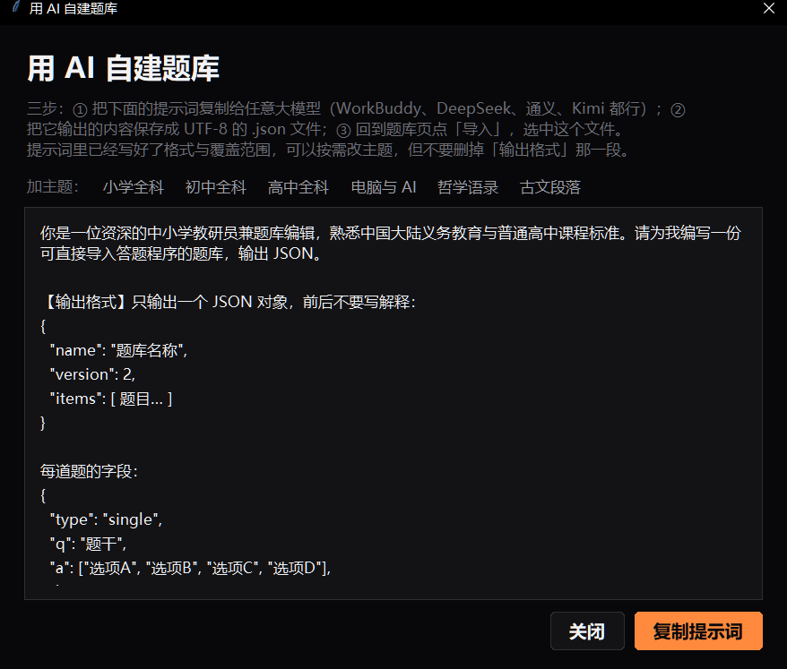

| 规则设置 | 关于页面 |
| --- | --- |
| 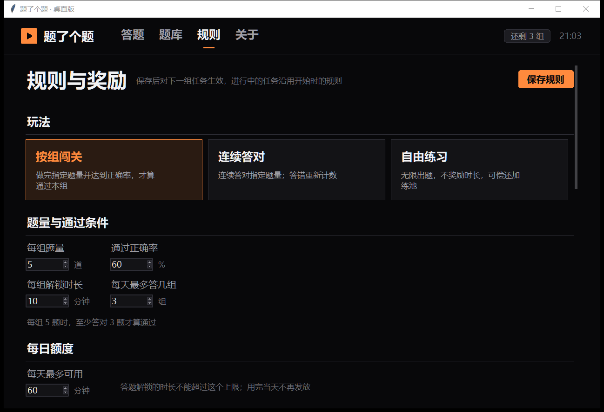 | 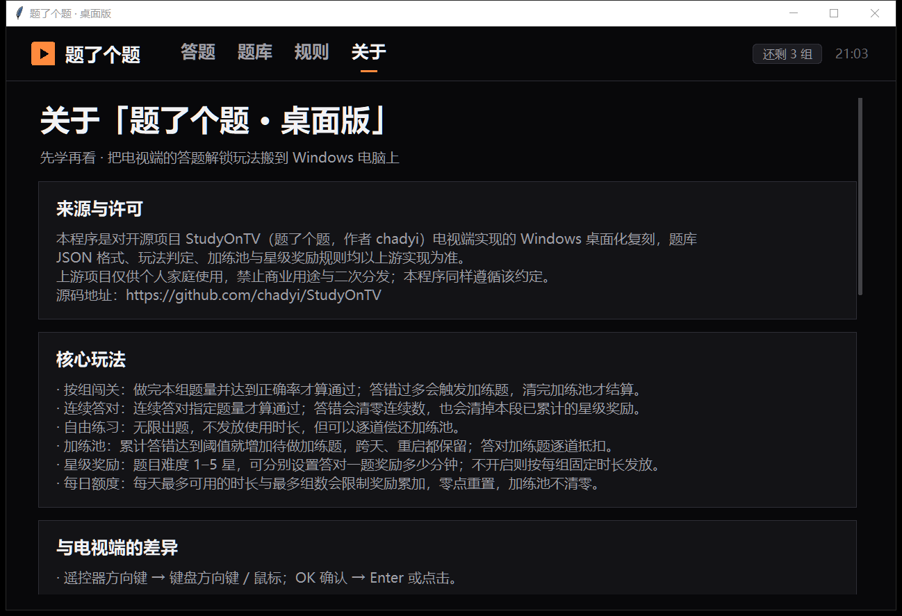 |

深色是默认主题，规则页可切换浅色：

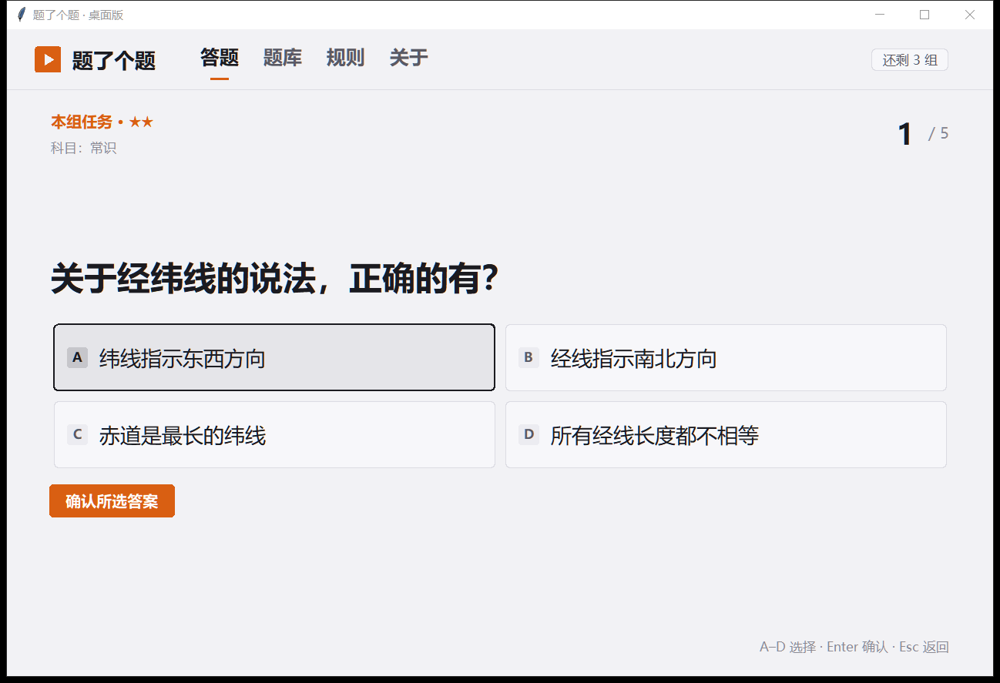

设了家长密码之后，启动就是全屏锁屏：中间答题，底部一条额度栏。

| 锁屏封面 | 答题中 |
| --- | --- |
| 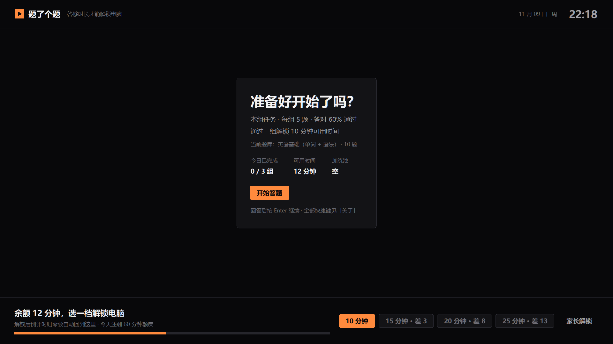 | 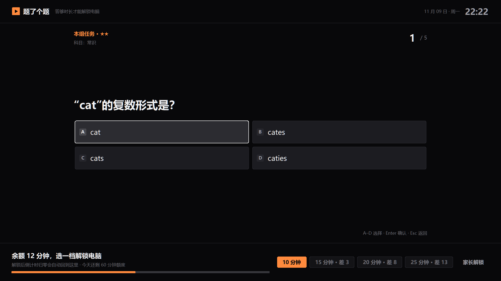 |

解锁后桌面上只留一条计时条。到剩 30 秒时整条放大三倍并闪烁，顺便把系统声音关掉——视频、游戏再开着也不会响：


规则页底部的家长分区（档位、加固开关、改密码）：

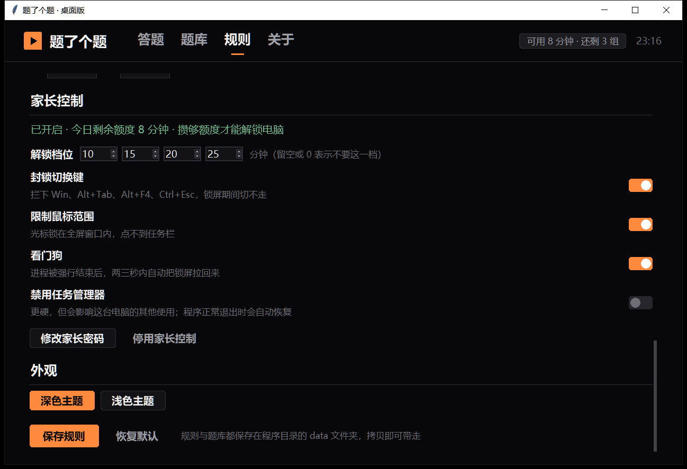

---

## 四、核心玩法（与上游判定一致）

### 三种玩法

| 玩法 | 通过条件 | 说明 |
| --- | --- | --- |
| 按组闯关 `round` | 做完本组题量，答对数 ≥ `ceil(题量 × 通过率)` | 答错累计到阈值会触发加练题，加练池清空才算结算 |
| 连续答对 `streak` | 连续答对指定题量 | 答错清零连续数，本段已累计的星级奖励一并清掉 |
| 自由练习 `practice` | 无 | 无限出题，不发放时长，但可以逐道偿还加练池 |

### 加练池

- 累计答错达到 `wrongThreshold`（默认 3）→ 加练池 +`extraQuestions`（默认 2）。
- 加练池**跨天、跨重启保留**；答对加练题逐道抵扣，答错不增加。
- `finished = 本组做完 && (!通过 || 未开启加练 || 加练池 == 0)`：通过但池子没清，也要把加练题做完才结算。

### 星级奖励与每日额度

- 题目难度 1–5 星，`difficultyRewards` 可为每档单独设奖励分钟（支持小数）；不开启则按每组 `sessionMinutes` 固定发放。
- 每组奖励先算「本题应得」，再按剩余额度截断：`grant = min(应得, 每日额度 - 今日已得)`。
- 每天 `roundsPerDay` 组、`dailyMinutes` 分钟封顶，零点重置；加练池不清零。

### 间隔重复（可选）

答对：`1 天 → 6 天 → 上次间隔 × ease`；答错：10 分钟后重来，`ease` 每次 -0.2，下限 1.3。出题时优先抽到期的题。

### 判定规则

| 题型 | 判定方式 |
| --- | --- |
| 单选 `single` / 判断 `boolean` | 选项下标等于 `k` |
| 多选 `multiple` | `correctIndices` 集合与所选集合完全相等（少选多选都不算对） |
| 填空 `text` | `answers` 任一命中；比较前先做 NFKC 归一化 → 转小写 → 压缩空白 |
| 主观 `subjective` | 提交后自评（对照 `modelAnswer` / `rubric`） |

---

## 五、家长控制

**默认开启，且第一次运行绕不过去。** 没有家长密码时，程序启动就是一个全屏的「设置家长密码」页：
设好密码（并抄下恢复码）立刻进入答题锁屏，不需要重启；不想设就点「退出程序」，程序直接关掉，
桌面原样还给你——**绝不会停在一个人人都能点的普通窗口里**。

这条规则是 v0.3.1 改的。老版本第一次运行是个普通窗口，关掉设置向导之后更永久变成普通窗口，
孩子只要抢在前头点一下「稍后再说」，整套锁屏就彻底失效了。

只有两种情况不会锁屏：家长在设置里主动停用家长控制，或者用 `unlock.flag` 临时放行（见下文）。

### 首次设置是什么样

| 环节 | 行为 |
| --- | --- |
| 进入 | 全屏无边框、置顶，盖住任务栏，看不到桌面 |
| 填密码 | 至少 6 位，输两次；密码只存 PBKDF2 派生值，不可逆推 |
| 恢复码 | 生成一次性 `XXXX-XXXX`，强制展示，请抄在课本扉页或贴在显示器背面 |
| 完成 | 点「我已抄下，开始答题」→ 同一秒切进答题锁屏 |
| 不设 | 点「退出程序」或按 Esc → 程序退出，下次启动重新要求设置 |

### 启用之后是什么样

启动即进全屏锁屏，除了答题什么都干不了。答够时长攒出额度，点底部档位换自由时间；时间一到，锁屏无条件回来。

| 环节 | 行为 |
| --- | --- |
| 攒额度 | 一组题按正确率与星级给分钟数；攒够 10 分钟才能换第一档 |
| 换时间 | 底部四档 10 / 15 / 20 / 25 分钟，余额够的才亮，不够的显示「还差 N 分钟」 |
| 解锁中 | 主窗口收起，桌面只留一条可拖动的倒计时条，显示剩余 MM:SS（超过 1 小时显示 H:MM:SS） |
| 最后 60 秒 | 说明变成「快结束了」，时间转成强调色 |
| 最后 30 秒 | 整条放大到三倍（字号、内边距、按钮同步放大），时间、边框、圆点一秒一闪，说明变成「记得保存」——给孩子留出存视频、退游戏的时间 |
| 到点 | 无提示、无过渡，直接全屏回锁，并**关掉系统声音**（视频/游戏还开着也哑了）。不会弹「时间到了」——弹窗本身就是可操作的空档 |
| 提前结束 | 点计时条上的「结束」，放弃剩余时间立刻回锁，同样静音 |
| 再解锁 | 换到自由时间的那一刻把声音原样还回去；锁屏前本来就是静音的不动它 |

### 锁屏期间拦住什么

| 操作 | 结果 |
| --- | --- |
| Win 键、Win+X、Win+D | 拦下 |
| Alt+Tab、Alt+Esc、Alt+F4 | 拦下 |
| Ctrl+Esc、Ctrl+Shift+Esc | 拦下 |
| 鼠标点任务栏 | 拦下（全屏置顶盖住任务栏，光标也锁在窗口内） |
| 别的程序抢前台 | 每两秒抢回来 |
| 任务管理器结束进程 | 挡不住，但两三秒后看门狗会把锁屏拉回来 |
| Ctrl+Alt+Del | 拦不住。这是 Windows 保留的安全注意序列，用户态程序没有权限 |

**这不是内核级管控。** 程序能做到的是把「随手绕过」全部堵死，把绕过成本抬到需要懂技术、且敢改系统。要绝对封死得换受限账户并替换系统外壳，那属于另一个量级，本版不做。

### 家长密码能做什么

锁屏页底部有「家长解锁」四个字。输密码后可以：

- 临时解锁 45 分钟，或解锁到明天零点
- 立即回锁
- 打开设置（改规则、改档位、改加固开关、换题库）
- 退出程序

「进入设置也需要密码」是硬性要求，所以锁屏下没有导航栏；家长验证后才会切到带导航的界面，右上角有「返回锁屏」。

密码连错 5 次开始冷却，依次 60 / 120 / 300 / 900 秒，重启程序不会清零。设置密码时会强制给一个 8 位恢复码，忘了密码可以用它重设。

### 四个加固开关

规则页「家长控制」分区里可以逐个关掉，默认全开（前三项）。

| 开关 | 作用 | 关掉的后果 |
| --- | --- | --- |
| 封锁切换键 | 拦 Win / Alt+Tab / Alt+F4 等 | 全屏窗口随便 Alt+Tab 就走了 |
| 限制鼠标范围 | 光标锁在全屏窗口内 | 鼠标能跑到任务栏和别的窗口 |
| 看门狗 | 主进程被杀后自动拉起 | 任务管理器结束进程即可绕过 |
| 禁用任务管理器 | 更硬一层 | 影响整台电脑，程序正常退出时会自动恢复 |

### 三条补救通道

| 场景 | 办法 |
| --- | --- |
| 忘了密码 | 密码框里点「忘记密码」，用抄下的恢复码重设 |
| 程序异常、急用电脑 | 程序目录放一个空的 `unlock.flag` 文件，再启动；程序会跳过锁屏并自动删掉这个文件 |
| 以后不想用了 | 锁屏 → 家长解锁 → 打开设置 → 「停用家长控制」 |

### 两个已知限制

**多显示器只锁主屏。** 锁屏窗口只覆盖主屏，光标也被限制在主屏矩形内，但副屏的桌面仍然可见、可点。要连副屏一起锁需要给每个屏幕建窗口，本版没做。

**关机、重启、注销不拦。** 强行截断属于系统级操作，拦了容易把系统搞坏，收益与风险不匹配。

---

## 六、题库

题库就是 `data/banks/` 下的一个 JSON 文件。界面里可以做全套操作：新建、导入、导出、切换、重命名、增删改题、保存；改动即时写盘。

### 左栏：管理题库

| 操作 | 位置 | 说明 |
|---|---|---|
| 切换 | 点行内任意处 | 切换正在编辑的题库，左边橙色竖条标记 |
| 是否参与出题 | 行右侧开关 | 打开即加入抽题范围，立刻生效 |
| 删除 | 行右侧「删除」 | 确认后移进 `data/trash/`，不会真的销毁 |
| 全部参与 | 标题右侧「全选」 | 一次把所有题库都纳入抽题范围 |
| 新建 / 导入 | 底部第一排 | 空白题库 / 从文件导入 |
| 自建题库 / 恢复内置 | 底部第二排 | 见下面两节 |
| 清空错题库 | 打开错题库时右上角 | 只在编辑「错题库」时出现，清空后不再长回来 |

程序自带 **8 份内置题库**（六年级至初一：语文、数学、英语、诗歌、历史、常识、安全、其他），每份 100 题。内置题库在列表里标「内置」；删掉之后**不会自己回来**，想找回点「恢复内置」。

### 错题库：答错自动收集

答错一道题（含主观题自评「没答对」），程序就把这道题**复制**进 `data/banks/错题库.json`，列表里标「自动收集」。第一次生成时自动加入出题范围，以后出题就跟着一起随机抽——错题会借间隔重复（答错 10 分钟后到期）很快再出现一次。

| 行为 | 说明 |
|---|---|
| 去重 | 按内容（题干 + 选项 + 答案）判重，同一道题错十次也只收一份 |
| 答对 | **不会**从错题库删掉。用户的诉求是「全部收集」，删不删由人决定 |
| 不想混进日常出题 | 把错题库那一行的开关关掉即可，收藏照旧，答错时也不会强行打开 |
| 只想清掉一部分 | 打开错题库，在右侧表格里选中题目删；想全清点「清空错题库」 |
| 删掉整个错题库 | 走「删除」进回收站；以后再答错会自动重建 |
| 两个题库里同一道题 | 出题池按内容去重，同一轮不会连着出同一题 |

错题库是普通题库文件，能编辑、导出、导入、改名——不需要另一套操作习惯。

### 多选题库混合出题

默认只有「当前打开的那一份」参与抽题。把其他题库的开关也打开，答题时就在这几份里一起随机抽——状态栏会显示「出题范围 3/8 份 · 300 题」。

- 跨库抽题仍然尊重规则页的科目 / 年级筛选，以及每道题的「暂停」状态。
- 两份题库里出现同一道题的 id 时（常见于复制出来的题库），程序会自动给其中一份加文件名前缀，间隔重复的进度不会串题。
- 同一个**内容**出现在两份题库里时（最常见的就是错题库里那道题还没从原题库删掉），出题池只留一份，同一轮里不会重复出同一题。

### 用 AI 自建题库

点左下「自建题库」，会弹出提示词全文，一键复制：

1. 先把提示词里「【背景及学习阶段】」那行改成自家情况（省份、年级、上/下册、期中还是期末）；
2. 整段粘给任意大模型（WorkBuddy、DeepSeek、通义、Kimi 都行）；
3. 把它输出的 JSON 存成 UTF-8 的 `.json` 文件（存成 `.txt` 也行），回来点「导入」选中该文件。

提示词里写死了本程序的字段格式、评分口径、质量红线与自检清单，内容范围覆盖小学到高中全学科，另有生活常识、电脑与网络、人工智能、哲学与思想、古文精彩段落等通识专题，还要求先出各章节知识点汇总（md）、再按重要程度分配题量。

按提示词里的默认数量（语数英各 200 题、其他各 100 题），一次要 500 道容易被模型截断：可以按科目分开要，缺了就让它在原文件后面接着补。只想出某一类题（比如只出古文段落），在末尾补一句「本次只出古文段落」即可。

程序读取时会自动剥掉 AI 输出常见的 ```json 代码块和前后解释文字，不用手动清理。

### 文件格式

```json
{
  "name": "英语基础",
  "version": 2,
  "items": [
    {
      "id": "q_1a2b3c4d5e6f",
      "type": "single",
      "q": "「苹果」用英语怎么说？",
      "a": ["apple", "banana", "orange", "pear"],
      "k": 0,
      "difficulty": 2,
      "tip": "apple 是可数名词，复数是 apples。",
      "subject": "英语",
      "level": "小学",
      "enabled": true
    }
  ]
}
```

| 字段 | 说明 |
| --- | --- |
| `type` | `single` / `multiple` / `boolean` / `text` / `subjective` |
| `q` | 题干，纯文本，可用 `\frac{a}{b}`、`\times` 等常见 LaTeX 写法（程序会转成 `(a)/(b)`、`×`） |
| `a` | 选项数组，2–8 个；判断题固定「正确 / 错误」 |
| `k` | 单选 / 判断的正确答案下标（从 0 开始） |
| `correctIndices` | 多选题的正确答案下标数组 |
| `answers` | 填空题的可接受答案数组（任一命中即算对） |
| `modelAnswer` / `rubric` | 主观题的参考答案 / 评分标准，自评时显示 |
| `difficulty` | 难度 1–5，决定星级奖励 |
| `tip` | 解析，答题反馈里显示 |
| `subject` / `level` | 科目 / 年级，用于规则页的出题范围筛选 |
| `enabled` | 是否参与抽题 |

只认两种兼容写法：上面这种对象（`items` 数组），或直接是题目数组；也兼容 `{"questions": [...]}`。缺 `id` 时会自动补一个，缺 `difficulty` 按 2 星处理。

### 导入外部题库

题库页「导入」支持 `.json`、`.txt`、`.md`，程序会复制进 `data/banks/`（同名自动加序号，不覆盖已有文件）。导入时问一句：新建一份，还是并进当前题库。

想批量造题，也可以直接把 JSON 放进 `data/banks/`，再切到别的页面回到题库，左栏列表就会刷新。

---

## 七、快捷键

| 按键 | 作用 |
| --- | --- |
| `A`–`H` / `1`–`8` | 选择对应选项（单选题直接提交） |
| `↑ ↓ ← →` | 移动高亮项 |
| `Enter` / `空格` | 确认：单选提交高亮项，多选确认已勾选项 |
| `Ctrl + Enter` | 填空 / 主观题输入框内提交 |
| `Esc` | 返回封面页；使用计时中结束计时 |
| 鼠标 | 点卡片选答案、点按钮，全部功能都能用鼠标完成 |

---

## 八、数据与备份

```
题了个题-桌面版/
├─ 启动.bat / 调试启动.bat     # 双击运行
├─ run.py                      # 入口（DPI 感知 + 启动兜底）
├─ build_package.py / build_installer.py / build_source.py   # 打包：exe 目录、安装包、源码 zip
├─ build/                      # NSIS 脚本、图标、版本资源
├─ quizwin/
│  ├─ core/
│  │  ├─ paths.py              # 数据目录判定、内置题库铺设
│  │  ├─ models.py             # Question / Bank：题库模型、校验、读写
│  │  ├─ rules.py              # Rules：玩法与奖励参数、通过题数计算
│  │  ├─ engine.py             # Engine：状态机（开始 / 作答 / 加练 / 结算 / 计时 / SM-2 / 收错题）
│  │  ├─ wrongbook.py          # WrongBook：错题库读写、内容指纹去重
│  │  ├─ mute.py               # MuteGuard：锁屏关声音、解锁还原、崩溃残留兜底
│  │  └─ storage.py            # 本地存储：题库目录、state.json 原子写
│  ├─ winapi/
│  │  ├─ harden.py             # 按键拦截、锁光标、抢前台
│  │  ├─ watchdog.py           # 守护进程：主进程被杀后拉起
│  │  └─ audio.py              # 系统静音开关（ctypes 调 Core Audio，可读可写）
│  └─ ui/
│     ├─ app.py                # 主窗口、导航、主题、全局快捷键
│     ├─ page_quiz.py          # 答题六种视图
│     ├─ page_bank.py          # 题库管理（切换 / 出题开关 / 删除）+ 题目编辑对话框
│     ├─ bank_prompt.py        # 「自建题库」的 AI 提示词与对话框
│     ├─ page_rules.py         # 规则设置
│     ├─ page_about.py         # 关于页
│     ├─ theme.py              # 配色、字体、圆角绘制、深色标题栏
│     └─ widgets.py            # 自绘按钮 / 选项卡片 / 开关 / 细滚动条等
├─ data/
│  ├─ banks/*.json             # 题库（8 份内置 + 自己加的 + 错题库）
│  ├─ state.json               # 规则、进度、加练池、历史
│  ├─ trash/                   # 删除题库时的回收站
│  └─ error.log                # 界面异常记录（有异常才出现）
├─ tests/                      # 引擎与界面冒烟测试
├─ tools/                      # 截图、启动验证等开发脚本
├─ docs/
│  ├─ 家长控制方案.md          # 家长控制的设计取舍与加固定位
│  └─ 开发过程.md              # 从需求到发布的过程记录
└─ shots/                      # 本文档用的截图
```

- 所有数据都在本地 `data/`，拷贝整个文件夹即可迁移，换机器不用重新配。
- 删题库不会真删文件，而是移进 `data/trash/`。
- 错题库就是 `data/banks/错题库.json` 一个普通文件：想归档就复制走，想重来就删掉（下次答错会重建）。
- 想清空进度：关掉程序，删除 `data/state.json` 即可（题库文件不动）。

**安装版的数据在哪：** 装到 `%LOCALAPPDATA%\Programs` 之后，程序目录对普通用户是只读的，数据改放

```
%LOCALAPPDATA%\题了个题\data\
├─ banks\            # 题库（内置 8 份会自动补齐，缺失的逐份补）
├─ state.json        # 规则、进度、家长密码哈希
├─ trash\            # 删题库的回收站
└─ runtime\          # 看门狗心跳、退出令牌
```

内置题库按「逐份补齐」处理：每次启动检查 `data/banks/` 里缺哪一份就补哪一份，同名文件绝不覆盖（你改过的内容优先），被你主动删掉的内置题库记在 `state.json` 的 `banks_removed` 里，不会下次启动又冒出来。

路径判定在 `quizwin/core/paths.py`，三条规则从高到低：

| 优先级 | 条件 | 数据目录 |
| --- | --- | --- |
| 1 | 设了环境变量 `QUIZWIN_DATA` | 该变量指向的路径（测试用） |
| 2 | exe 旁边有 `portable.flag` 且该目录可写 | `程序目录\data`（便携版） |
| 3 | 其余情况（含安装版） | `%LOCALAPPDATA%\题了个题\data` |

界面上「关于 → 数据位置」显示的就是真实路径，「打开数据文件夹」按钮直接打开它。

---

## 九、与电视端的差异

| 电视端（Android TV） | 桌面版 |
| --- | --- |
| 遥控器方向键移动焦点、OK 确认 | 键盘方向键 / 鼠标点击、Enter 确认 |
| 解锁时长后拦截第三方视频应用 | 不针对单个应用；锁屏期间整机封锁（键盘钩子 + 全屏置顶 + 光标限制 + 看门狗），解锁后完全放开 |
| 家长面板（React / 局域网扫码） | 未包含；改为本机「规则」页的家长分区，进入需密码 |
| AI 批改主观题 | 未包含，改为对照参考答案自评 |
| 防卸载、设备管理 | 部分对应：看门狗互保（进程被杀 2–5 秒回锁）；不做账户级封锁与设备管理 |
| 竖屏 TV 布局、更大字号与焦点描边 | 1280×840 桌面窗口，两列选项卡、内容垂直居中、DPI 感知 |

判定规则、加练池、星级奖励、每日额度、间隔重复这几块逻辑与上游 `LearningEngine.kt` 一一对应，**分数与通过与否的结果一致**。

---

## 十、自测

```bat
python tests\engine_smoke.py          :: 引擎 60 项：三种玩法、加练池、额度、归一化、SM-2、题库读写
python tests\ui_smoke.py              :: 真实建窗：逐页渲染、作答、主题切换、对话框、计时页、拦截页
python tests\parent_lock_smoke.py     :: 家长控制 94 项：密码哈希、恢复码、错误冷却、锁定状态机、时钟篡改
python tests\lock_ui_smoke.py         :: 锁屏链路 52 项：兑换 → 计时条尺寸 / 30 秒放大三倍并闪烁 / 静音 → 到点回锁
python tests\mute_smoke.py            :: 锁屏静音 32 项：关掉与还原、原本静音不擅动、重复调用、崩溃残留恢复、无声卡降级
python tests\dialog_layout_smoke.py   :: 对话框布局与销毁后回调
python tests\settings_mode_smoke.py   :: 家长从锁屏进设置再回锁屏
python tests\harden_smoke.py          :: 按键拦截判定、钩子装卸、看门狗决策
python tests\guard_wiring_smoke.py    :: 封锁时序：锁时装、解锁时卸、回锁时重装
python tests\guard_relaunch_smoke.py  :: 真起守护进程，真杀父进程，验证重启决策
python tests\first_run_smoke.py       :: 首次运行 35 项：默认进锁屏、全屏设置、跳过即退出、设完立刻回锁
python tests\bank_pool_smoke.py       :: 题库 74 项：多库混合抽题、id 撞车、删除、内置恢复、AI 提示词、AI 输出容错
python tests\bank_ui_smoke.py         :: 题库页界面 40 项：勾选出题范围、删除确认、恢复内置、提示词复制与折行、错题库入口
python tests\wrongbook_smoke.py       :: 错题库 49 项：自动收集、内容去重、自动进入范围、清空、删除后重建、编辑中收录
```

十四套共 **566 项**，全绿再打包。

> 后两套会真的起守护进程。它们用 `QUIZWIN_GUARD_DRY=1` 让「重启锁屏」只留痕不真执行，
> 因此不会在跑测试时把桌面锁住。

开发用工具（`tools/`）：

- `shot.py`：切页并截图（`--answer` / `--result` / `--watch` / `--blocked` / `--light` / `--dialog` / `--bank` / `--type`）
- `shot_rules.py`：滚到规则页底部，截「家长控制」分区
- `harden_probe.py`：装 20 秒键盘钩子并统计吞键次数，用来亲手验证 Alt+Tab 是否真被拦
- `launch_check.py`：真的调用 `启动.bat`，确认窗口能起来再关掉
- `window_shot.py`：按窗口标题抓截图，用于验证打包后的 exe（没有 tkinter 句柄可用）
- `press_enter.py`：给安装向导发回车翻页，配合 `window_shot.py` 逐页核对
- `keypad.py`：给前台窗口打字/按键/点击，用来打通「首次设置」这种只能靠人手点一次的流程
- `shot_prompt.py`：只截「自建题库」对话框本身，重生成 `shots/16-AI自建题库.png`
- `shot.py --wrongbook`：造几条错题并切到错题库，重生成 `shots/17-错题库.png`
- `shot.py --overlay <秒>`：解锁后把剩余时间定在指定秒数，截计时条（`--overlay 25` 就是三倍放大版）
- `uninstall_silent.py`：静默卸载已安装的程序（绕开 Git Bash 的 `/S` 转换）
- `make_shots.py`：批量生成 `shots/` 里的展示图
- `make_launcher.py`：重新生成 GBK 编码的启动脚本

---

## 十一、打包

三件事，都要用**带 tkinter 的** Python：

```bat
python build_package.py      :: PyInstaller  → dist\题了个题\（免安装目录）
python build_installer.py    :: NSIS         → dist\题了个题-0.3.6-安装版.exe（8.4 MB）
python build_source.py       :: zipfile      → dist\题了个题-0.3.6-源码版.zip（1.1 MB）
```

顺序不能换：`build_package.py` 开头会 `rmtree(dist)`，所以源码版必须最后打。

本机 PATH 上的 `python` 是不带 tkinter 的托管版（3.13.12），得用系统那个：

```bat
"%LOCALAPPDATA%\Programs\Python\Python313\python.exe" build_package.py
"%LOCALAPPDATA%\Programs\Python\Python313\python.exe" build_installer.py
"%LOCALAPPDATA%\Programs\Python\Python313\python.exe" build_source.py
```

| 文件 | 作用 |
| --- | --- |
| `build_package.py` | 生成 `dist\题了个题\`：onedir、无控制台、带图标与版本资源 |
| `build_installer.py` | 编译 NSIS 脚本，自动给 `.nsi` 补 UTF-8 BOM，输出安装包 |
| `build_source.py` | 按 `git ls-files` 收文件打源码 zip，附一份「源码版说明.txt」，打完自检夹带 |
| `build\installer.nsi` | 安装脚本本身：装到 `%LOCALAPPDATA%`、卸载项写 HKCU、可选开机自启 |
| `tools\make_icon.py` | 生成 `build\app.ico`（256→16 七个尺寸） |
| `tools\make_installer_art.py` | 生成安装向导的 `welcome.bmp` / `header.bmp` |
| `build\tools\nsis\nsis-3.11\` | NSIS 3.11 绿色版，解压即用，不往系统里装东西 |

几个踩过的坑，改打包流程前先看：

1. **必须用带 tkinter 的解释器。** 用托管版打出来能启动、但一开界面就报「No module named tkinter」。`build_package.py` 会先检查并直接劝退。
2. **用 onedir，不用 onefile。** onefile 每次启动都要把 26 MB 解包到临时目录，冷启动 3–5 秒，杀毒软件对自解压行为也更敏感。
3. **数据不能写程序目录。** 装进 `C:\Program Files` 后普通用户没有写权限，老写法会把进度存在 `data\` 里然后静默失败。现在按 `quizwin/core/paths.py` 的三级规则判定，见第八节。
4. **安装器「立即运行」要配 `Sleep 2000`。** PyInstaller 程序启动时还在加载 DLL，安装器点完成就退出会把它掐断，表现是「点了完成没反应、程序没起来」。加上这段等待后实测能正常拉起。
5. **NSIS 脚本必须带 UTF-8 BOM**，否则向导里的中文全是乱码方块；`build_installer.py` 每次编译前自动补。
6. **杀进程要绕开 Git Bash。** 卸载器带 `/S` 静默参数时会被 MSYS 当成路径转换掉，得用 Python 的 `subprocess` 直接调，`tools\uninstall_silent.py` 就是干这个的。

便携版怎么出：把 `dist\题了个题\` 整个拷到 U 盘，在 `题了个题.exe` 旁边放一个空的 `portable.flag`，数据就写在该目录的 `data\` 里，拔盘即走。

---

## 十二、许可

**本项目仅为个人学习使用性质的桌面复刻**，不对上游任何素材主张权利，请勿用于商业用途。

上游 **StudyOnTV**（作者 chadyi）是 Kotlin / Android TV 实现，其声明为「仅供个人家庭使用，禁止商业用途与二次分发」。本程序参照其规则引擎与题库格式做了 Windows 端复刻，仅供个人学习与家庭自用，不随附上游任何代码或美术资源。

题库内容为示例数据，可自行替换。若上游作者认为本项目存在不妥，在本仓库提 Issue 即可，我会立即处理。
